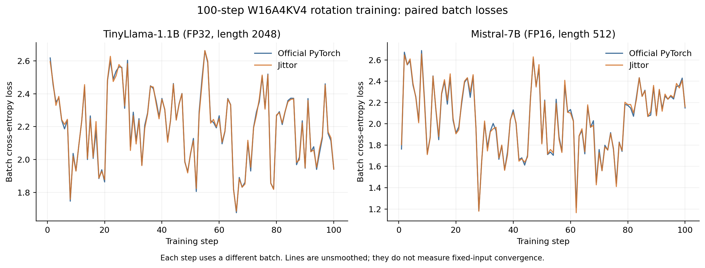
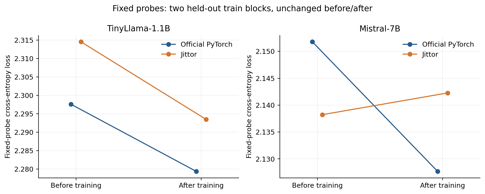
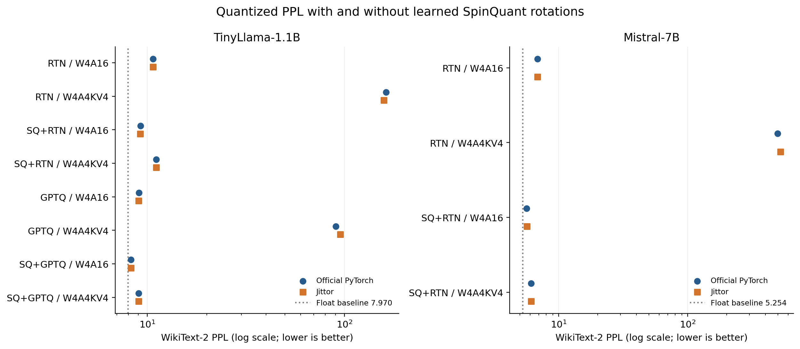
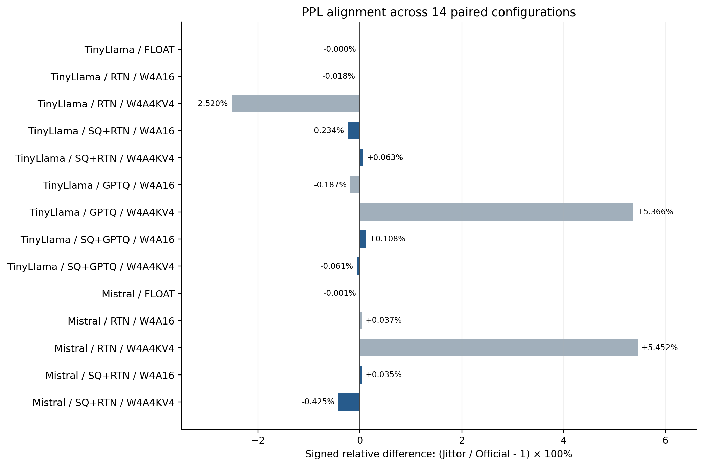

# SpinQuant 的 Jittor 复现与 PyTorch 对齐实验

使用 Jittor 实现 SpinQuant 的单卡核心流程：R1/R2 正交旋转学习、RMSNorm 融合、R3/R4 Hadamard 变换、RTN/GPTQ 权重量化、激活与 K/V 伪量化，并在 WikiText-2 上评测困惑度（PPL）。

论文：[SpinQuant: LLM Quantization with Learned Rotations](https://arxiv.org/abs/2405.16406)，ICLR 2025；参考：[Meta 官方 PyTorch 实现](https://github.com/facebookresearch/SpinQuant)，固定提交 `8f47aa3f00e8662caf1a484153920a07e5281c3a`。

**本实验采用 W16A4KV4 旋转训练，seed=0，于 2026-11-18 完成**：4 次 100 步旋转训练、28 项 PPL、14 组 PyTorch/Jittor 对照、400 个逐步 Loss、32 条任务性能记录。所有正式任务成功退出。

本项目是资源受限的算法移植与对齐实验。两端均采用浮点算子模拟低比特量化，未实现 INT4 权重打包或 INT4 GEMM；结果不能作为真实低比特部署加速结论。

## 1. 任务材料与文件结构

| 任务要求 | 本仓库位置 |
|---|---|
| 环境配置 | 本文第 2 节、[Jittor 配置](environments/jittor_environment.txt)、[PyTorch 配置](environments/pytorch_environment.txt)、[实际完整依赖快照](experiments/environments/) |
| 数据准备脚本 | [prepare_data.py](prepare_data.py)、[Mistral 格式转换](convert_mistral_safetensors.py)、第 3 节 |
| 训练脚本 | [run_train_rotation.sh](run_train_rotation.sh)、[统一实验入口](run_full_experiment.py)、第 4 节 |
| 测试脚本 | [run_eval_ptq.sh](run_eval_ptq.sh)、[统一实验入口](run_full_experiment.py)、第 5 节 |
| 与 PyTorch 对齐的实验 Log、Loss、结果及可视化 | 第 6 节每行原始 Log、[完整结果报告](experiments/report.md)、[Loss CSV](experiments/training_loss.csv)、[曲线](experiments/figures/) |
| 性能 Log | 第 7 节、[32 条性能汇总](experiments/performance.csv)、[GPU 原始采样](experiments/gpu_samples.jsonl)、每项 `.exit.json` 与结果 JSON |

```text
.
├── README.md
├── LICENSE
├── requirements.txt
├── pyproject.toml
├── environments/                   # 两套环境关键版本
│   ├── jittor_environment.txt
│   └── pytorch_environment.txt
├── prepare_data.py                 # WikiText-2、模型下载与校准 token 准备
├── convert_mistral_safetensors.py   # CPU 无损格式转换
├── run_train_rotation.sh           # 官方风格的一行 Jittor 训练入口
├── run_eval_ptq.sh                 # 官方风格的一行 Jittor 评测入口
├── run_full_experiment.py           # 本实验统一实验协议的可配置入口
├── jittor_spinquant/                # 正式 Jittor 实现
│   ├── __init__.py
│   ├── arguments.py                # 命令行参数与配置检查
│   ├── misc.py                     # 日志、种子等通用辅助
│   ├── core/
│   │   ├── __init__.py
│   │   ├── model.py                # Jittor Llama 模型
│   │   ├── quant_linear.py         # 量化线性层与激活包装
│   │   └── fuse_norm.py            # RMSNorm 融合
│   ├── io/
│   │   ├── __init__.py
│   │   ├── loader.py               # 权重、配置和 tokenizer 加载
│   │   └── data_utils.py           # WikiText-2 校准与评测数据
│   ├── math/
│   │   ├── __init__.py
│   │   ├── hadamard.py             # Hadamard 变换
│   │   └── hadamard_data.npz        # Hadamard 常量数据
│   ├── pipeline/
│   │   ├── __init__.py
│   │   ├── prepare.py              # 旋转融合与量化准备
│   │   ├── evaluator.py            # WikiText-2 PPL 计算
│   │   └── eval_ptq.py             # 单框架 PTQ 评测入口
│   ├── quant/
│   │   ├── __init__.py
│   │   ├── quantization.py         # 量化参数、激活与 K/V 伪量化
│   │   ├── rtn.py                  # RTN 权重量化
│   │   ├── gptq.py                 # GPTQ 逐层校准与量化
│   │   └── gptq_math.py            # Hessian 统计与矩阵分解
│   ├── rotation/
│   │   ├── __init__.py
│   │   ├── rotation_utils.py       # R1/R2 旋转与权重融合
│   │   └── optimizer.py            # SGDG / Cayley 优化
│   ├── train/
│   │   ├── __init__.py
│   │   └── train_rotation.py       # 单框架旋转训练入口
│   └── tools/
│       ├── __init__.py
│       └── verify_math.py          # 数学性质检查工具
├── tests/                          # CPU 数学、协议与发布回归检查
│   ├── test_full_experiment.py
│   ├── test_gptq_math.py
│   └── test_publication.py
└── experiments/
    ├── report.md                   # 本实验结果分析
    ├── summarize.py                # 核验原始证据、重建汇总 CSV
    ├── protocol.json / status.json / summary_status.json
    ├── results.csv / alignment.csv / rotation_gains.csv
    ├── training_loss.csv / training_summary.csv / loss_alignment_metrics.csv
    ├── performance.csv / gpu_samples.jsonl
    ├── runner.log                  # 统一实验调度日志
    ├── results/                    # 32 项原始结果 JSON
    ├── logs/                       # 正式任务及预检的 Log、命令、退出信息
    ├── training/                   # 4 份原始 100 步 Loss CSV
    ├── shared/                     # 训练索引、GPTQ 抽样偏移
    ├── environments/               # 实验时的两套 pip freeze
    ├── checks/                     # 预检、转换核验和完整本地归档审计
    ├── source/                     # 实际运行的官方/Jittor/统一入口冻结源码
    ├── figures/                    # Loss、PPL、相对差异与探针图
    └── *_sha256.json / publication_manifest.json / evidence_audit.json
```

模型权重、数据集正文、token 数组和学习后的旋转矩阵由脚本准备/生成，未放入源码仓库。PPT 和视频保留在本地，不属于本次代码发布清单。

## 2. 环境配置

实测平台：Linux x86_64，Python 3.10.22，单张 **NVIDIA RTX PRO 6000 Blackwell Server Edition，97887 MiB**，驱动 595.71.05，实际 CUDA Toolkit/nvcc 12.8.93，g++ 11.3.0。`nvidia-smi` 显示的 CUDA 13.2 是驱动支持上限，不是本实验编译使用的 Toolkit 版本。这是实测环境记录，不是最低硬件要求。

| 依赖 | Jittor 环境 | 官方 PyTorch 环境 |
|---|---|---|
| 框架 | Jittor 1.3.8.5 | PyTorch 2.11.0+cu128 |
| NumPy | 1.26.4 | 1.26.4 |
| Transformers | 5.20.2 | 4.44.2 |
| Tokenizers | 0.23.3 | 0.19.1 |
| Datasets | 5.1.0 | 2.20.0 |
| 完整实际快照 | [Jittor pip freeze](experiments/environments/jittor_pip_freeze.txt) | [PyTorch pip freeze](experiments/environments/official_pip_freeze.txt) |

分别安装两套环境。以下给出安装方式；本次整理只做 CPU 检查，未在一台全新 GPU 机器上重装验证。完整 freeze 记录包含服务器上其他已安装包，不能直接当作最小环境锁文件。

```bash
# 先准备可用的 NVIDIA 驱动、CUDA Toolkit、C++ 编译器和 conda。
conda create -n spinquant_jittor python=3.10.22 -y
conda activate spinquant_jittor
python -m pip install -r environments/jittor_environment.txt
python -m pip install --no-deps -e .

conda create -n spinquant_torch python=3.10.22 -y
conda activate spinquant_torch
python -m pip install torch==2.11.0+cu128 --index-url https://download.pytorch.org/whl/cu128
python -m pip install -r environments/pytorch_environment.txt
python -m pip install ninja packaging wheel
python -m pip install --no-build-isolation \
  'git+https://github.com/Dao-AILab/fast-hadamard-transform.git@e7706faf8d1c3b9f241e36860640ad1dac644ede'

# 在准备/运行实验的同一个 shell 中设置；替换为本机真实绝对路径。
export TORCH_PYTHON=/absolute/path/to/envs/spinquant_torch/bin/python
export JITTOR_PYTHON=/absolute/path/to/envs/spinquant_jittor/bin/python
export nvcc_path=/absolute/path/to/cuda/bin/nvcc
# 原实测 Blackwell 的计算能力为 12.0；其他 GPU 请按其计算能力设置。
export cuda_arch=120
# 若本机需要额外 CUDA 动态库目录，再设置 JITTOR_CUDA_LIB_DIR。
```

[requirements.txt](requirements.txt) 是通用运行依赖范围；重现本实验环境应以固定版本配置和实际快照为依据。Jittor 的 safetensors 路径不依赖 PyTorch；共享数据/初始化准备和 Mistral 格式转换在 PyTorch 环境运行。

## 3. 模型与数据准备

**模型身份以 [input_sha256.json](experiments/input_sha256.json) 为准。** TinyLlama 精确的上游仓库/revision 尚未确认，不能仅凭名称保证下载到同一模型。Mistral 使用 Mistral-7B-v0.1，两端读取同一份转换后的 safetensors；291 个张量与原 `.bin` 分片在 FP16 下逐一比较通过，见 [转换核验](experiments/checks/mistral_conversion.json)。

先取得合法可用的本地 HF 模型目录（config、tokenizer、权重）。`prepare_data.py` 默认只读本地文件；仅在传入下载参数时访问网络，不会自动替换模型或生成随机语料。

```bash
export TINYLLAMA_MODEL=/absolute/path/to/TinyLlama-1.1B
export MISTRAL_ORIGINAL=/absolute/path/to/Mistral-7B-v0.1
export MISTRAL_MODEL=/absolute/path/to/Mistral-7B-v0.1-safetensors
export WIKITEXT2_DIR="$(pwd)/data/wikitext-2-raw-v1"

# 数据尚未准备时：下载真实 WikiText-2 并生成 TinyLlama 校准/测试 token。
"$JITTOR_PYTHON" prepare_data.py \
  --model "$TINYLLAMA_MODEL" --wikitext-dir "$WIKITEXT2_DIR" \
  --download-wikitext --output ./outputs/shared_data

# Mistral 尚无 safetensors 时，无损转换至一个全新的目录；需 CPU 内存及磁盘空间。
"$TORCH_PYTHON" convert_mistral_safetensors.py \
  --source "$MISTRAL_ORIGINAL" --output "$MISTRAL_MODEL"
```

数据已在本地时去掉 `--download-wikitext`。默认数据 revision 为 `main`，可用 `--dataset-revision` 固定版本；输入是否相同仍以 SHA256 核验为准。需要下载模型时，使用新的空 `--model` 目录，并同时指定 `--model-id`、`--model-revision`，不预设一个未经确认的 TinyLlama revision。

`prepare_data.py` 输出 `calibration_ids.npy`（128×2048）、`test_ids.npy`（完整 token 流）、`shared_data.json`、`input_sha256.json`。使用与实验记录相同的 TinyLlama 权重/tokenizer/parquet 时，加 `--verify-recorded-tinyllama` 可核对本实验模型/数据哈希、GPTQ 抽样偏移与测试分块哈希。两套 Transformers 可能报告不同 tokenizer 类名，核验实际 token 字节，不以类名字符串代替内容核验。

统一实验入口在第 4 节的准备阶段生成两端共享的训练块、测试分块和初始化矩阵。它使用官方 `CustomJsonDataset` 的逐记录 token 拼接顺序，取前 100 块用于训练，不打乱；另外取最后两个未用于优化的 train 块作为固定探针。GPTQ 仅从 train split 用 seed=0 抽样 128×2048。评测使用完整 test split 文本以 `\n\n` 拼接，不额外加 BOS/EOS，按 2048 切成互不重叠的完整块、丢弃尾部；TinyLlama 为 166 块/339802 个预测目标，Mistral 为 163 块/333661 个预测目标。

Tokenization 时可能出现总 token 流超过 2048 的提示。模型实际按 2048 分块前向；总流长度提示本身不表示模型接收了超长序列，仍应以分块计数和最终成功退出为准。

## 4. 训练脚本、统一实验协议与训练 Log

### 4.1 一行 Jittor 训练与输出

[run_train_rotation.sh](run_train_rotation.sh) 采用官方脚本的 `MODEL W_BITS A_BITS KV_BITS` 形式，默认 W16A4KV4、100 步、cosine LR=1.5、每步记录 Loss；基座默认 FP32，旋转参数 FP32。

```bash
export MODEL_DIR="$TINYLLAMA_MODEL"
set -o pipefail
bash run_train_rotation.sh "$MODEL_DIR" 16 4 4 2>&1 | tee train.log

# Mistral 的显式单卡设置：FP16 基座、训练长度 512，独立输出目录。
bash run_train_rotation.sh "$MISTRAL_MODEL" 16 4 4 \
  --fp16 --model_max_length 512 --output_rotation_path ./outputs/mistral_rotation
```

默认输出 `outputs/rotation/R.npy`、`outputs/rotation/training_config.json`；可用 `OUTPUT_ROTATION_DIR` 或 `--output_rotation_path` 指定新目录。命名参数可覆盖脚本默认值，K/V 分组按模型 head_dim 解析（TinyLlama 64、Mistral 128）。训练只学习 R1/R2，GPTQ 在训练后的 PTQ 阶段执行。

**上述普通入口用于单框架训练/演示，未自动加载两端共享训练数组、共享初始矩阵，也未替代统一实验流程中的全局梯度裁剪和训练 RNG 控制。本文结果由下述统一入口产生。** 普通评测入口的浮点汇总精度也与统一评测适配器不同，结果不应混合统计。

### 4.2 统一训练与评测流程

[run_full_experiment.py](run_full_experiment.py) 在正式模型、旋转、量化和优化器模块外使用受控训练/评测循环。官方端调用冻结的官方模块，而非直接执行完整 Hugging Face Trainer。依据官方脚本和 Trainer 默认值设置 cosine LR=1.5、无 warmup、全局梯度范数裁剪 1.0，优化前 RNG 重置为 42；初始化/校准 seed=0。TinyLlama 两端 FP32、训练长度 2048；Mistral 两端 FP16、训练长度 512；均单卡、batch=1、梯度累积=1、旋转 FP32、W16A4KV4 训练 100 步。

```bash
# 先按第 2、3 节设置解释器、CUDA、三个模型目录和 WikiText-2 目录。
# RUN 必须是尚不存在的新目录，避免覆盖已完成的证据。
export RUN="$(pwd)/outputs/spinquant_experiment"
"$TORCH_PYTHON" run_full_experiment.py prepare --root "$RUN" \
  --tinyllama-model "$TINYLLAMA_MODEL" \
  --mistral-model "$MISTRAL_MODEL" --mistral-original "$MISTRAL_ORIGINAL" \
  --wikitext-dir "$WIKITEXT2_DIR" \
  --torch-python "$TORCH_PYTHON" --jittor-python "$JITTOR_PYTHON"

# prepare 只做数据/初始化准备与身份核验，不执行模型训练。
# run 先做四项两步预检，再依次执行 4 次训练与 28 项 PPL。
nohup "$TORCH_PYTHON" -u run_full_experiment.py run --root "$RUN" \
  > "$RUN/runner.log" 2>&1 < /dev/null &

# 查看进度和最终完成状态。
tail -f "$RUN/runner.log"
# 完成后检查 status.json 为 complete，summary_status.json 无 missing。
```

默认官方源码来自 [固定提交的官方源码快照](experiments/source/official/)，也可通过 `--official-source` 传入相同固定提交的干净源码（必须含 `scripts/`）。准备阶段记录输入/共享数组/源码哈希、环境、原权重转换核验和完整协议，准备阶段冻结源码，运行阶段逐任务保存 Log、命令、退出码、结果、旋转、Loss 和 GPU 采样。失败任务不作为结果；其依赖评测跳过。入口会拒绝重复运行同一目录，不支持中途恢复；需要重新运行时使用新目录。

实际产生实验结果的 [统一入口源码快照](experiments/source/run_full_experiment.py) 与原始日志一同保留，用于核验实验过程。核心 `jittor_spinquant/` 与源码快照逐文件一致。根目录入口支持通过命令行和环境变量指定模型、数据及解释器路径；发布时对可配置入口进行了静态和 CPU 检查，未重新执行完整 GPU 队列。

参考核验：[官方脚本/Trainer 默认记录](experiments/checks/official_reference.json)；完整参数：[protocol.json](experiments/protocol.json)。

### 4.3 本实验训练 Log 与 Loss

每组训练均有 100 条逐步记录，总计 400 条，step 从 0 到 99。cosine 最后一次参数更新的 LR 为 0.0003700797；100 次更新的最后一个取值无需恰好为 0。每步 batch 不同，不能只用首尾训练 Loss 作为优化效果判据；同时报告未参与优化的固定探针与最终 PPL。

| 模型 | 框架 | 首步 Loss | 末步 Loss | 100 步均值 | 固定探针：训练前 → 后 | 训练秒数 | 原始训练 Log |
|---|---|---:|---:|---:|---|---:|---|
| tinyllama | official | 2.617655 | 1.941846 | 2.207408 | 2.297577 → 2.279348 | 896.20 | [Log](experiments/logs/tinyllama_official_train_s0.log) / [JSON](experiments/results/tinyllama_official_train_s0.json) |
| tinyllama | jittor | 2.594762 | 1.940982 | 2.206670 | 2.314538 → 2.293454 | 174.15 | [Log](experiments/logs/tinyllama_jittor_train_s0.log) / [JSON](experiments/results/tinyllama_jittor_train_s0.json) |
| mistral | official | 1.762793 | 2.148301 | 2.045592 | 2.151770 → 2.127687 | 11297.91 | [Log](experiments/logs/mistral_official_train_s0.log) / [JSON](experiments/results/mistral_official_train_s0.json) |
| mistral | jittor | 1.804616 | 2.159429 | 2.046635 | 2.138227 → 2.142264 | 654.06 | [Log](experiments/logs/mistral_jittor_train_s0.log) / [JSON](experiments/results/mistral_jittor_train_s0.json) |

Mistral Jittor 的固定探针从 2.138227 升至 2.142264（约 +0.189%），应如实保留。两端逐步 Loss 相关系数 TinyLlama 0.99813、Mistral 0.99774，说明曲线形态接近，不能证明梯度、旋转或优化轨迹逐位相同。

[400 点 Loss CSV](experiments/training_loss.csv) · [训练概况](experiments/training_summary.csv) · [Loss 对齐统计](experiments/loss_alignment_metrics.csv) · [四份原始 Loss CSV](experiments/training/)





## 5. 测试脚本与评测设置

[run_eval_ptq.sh](run_eval_ptq.sh) 同样支持 `MODEL W A KV`，默认无参数为浮点基线；RTN 默认显式开启，GPTQ 需明确选择。加载学习旋转时同时传入 `--rotate` 和 Jittor 的 `R.npy`。

```bash
# 使用第 3 节设置的 MODEL_DIR、WIKITEXT2_DIR、JITTOR_PYTHON。
bash run_eval_ptq.sh "$MODEL_DIR" 16 16 16
bash run_eval_ptq.sh "$MODEL_DIR" 4 4 4
bash run_eval_ptq.sh "$MODEL_DIR" 4 4 4 \
  --rotate --optimized_rotation_path ./outputs/rotation/R.npy
bash run_eval_ptq.sh "$MODEL_DIR" 4 4 4 --w_quant_method gptq
bash run_eval_ptq.sh "$MODEL_DIR" 4 4 4 --w_quant_method gptq \
  --rotate --optimized_rotation_path ./outputs/rotation/R.npy
# W4A16 使用位置参数 4 16 16；Mistral 增加 --fp16 并切换模型路径。
```

普通评测将 PPL 输出到终端，可加 `2>&1 | tee eval.log` 保存。训练和评测分别使用上述两个 Shell 启动脚本。

本实验正式表格使用统一入口：全量 WikiText-2 test，长度 2048、batch=1、eager attention、不额外加 BOS/EOS，丢弃不足一个块的尾部；FP32 逐 token NLL、NumPy FP64 聚合后 `exp`。两端读取相同 token 数组，每项先预热 2 块，预热不计入评测循环计时。它是对官方模块的统一评测适配，不是官方原生 evaluator 的原样输出。

GPTQ 仅对 TinyLlama 执行：128×2048 train 校准 token，seed=0，blocksize=128，percdamp=0.01，act_order=False，权重分组 -1，w_clip=True，激活和 K/V 使用非对称量化、clip_ratio=1.0，K/V 分组为 head_dim。Mistral 本实验仅测试 RTN。W4A16 表示 W4、A/K/V 均 16；W4A4KV4 表示 W/A/K/V 均 4。

## 6. PPL 对齐结果与原始实验 Log

PPL 越低越好。下表相对差异为 `100 × (Jittor / PyTorch − 1)`；展示保留 6 位小数，[CSV](experiments/alignment.csv) 和 [原始 JSON](experiments/results/) 保留完整数值。每个 Log 同目录保存对应 `.command.json`、`.exit.json`。

| 模型 | 方法 | 精度 | 官方 PyTorch PPL | Jittor PPL | 相对差异 | PyTorch Log | Jittor Log |
|---|---|---|---:|---:|---:|---|---|
| tinyllama | FLOAT | FP32 | 7.970237 | 7.970223 | -0.0002% | [Log](experiments/logs/tinyllama_official_float_a16_s0.log) | [Log](experiments/logs/tinyllama_jittor_float_a16_s0.log) |
| tinyllama | RTN | W4A16 | 10.694103 | 10.692188 | -0.0179% | [Log](experiments/logs/tinyllama_official_rtn_a16_s0.log) | [Log](experiments/logs/tinyllama_jittor_rtn_a16_s0.log) |
| tinyllama | RTN | W4A4KV4 | 162.726562 | 158.625329 | -2.5203% | [Log](experiments/logs/tinyllama_official_rtn_a4_s0.log) | [Log](experiments/logs/tinyllama_jittor_rtn_a4_s0.log) |
| tinyllama | SpinQuant+RTN | W4A16 | 9.223419 | 9.201868 | -0.2336% | [Log](experiments/logs/tinyllama_official_sq_rtn_a16_s0.log) | [Log](experiments/logs/tinyllama_jittor_sq_rtn_a16_s0.log) |
| tinyllama | SpinQuant+RTN | W4A4KV4 | 11.092414 | 11.099380 | +0.0628% | [Log](experiments/logs/tinyllama_official_sq_rtn_a4_s0.log) | [Log](experiments/logs/tinyllama_jittor_sq_rtn_a4_s0.log) |
| tinyllama | GPTQ | W4A16 | 9.049361 | 9.032441 | -0.1870% | [Log](experiments/logs/tinyllama_official_gptq_a16_s0.log) | [Log](experiments/logs/tinyllama_jittor_gptq_a16_s0.log) |
| tinyllama | GPTQ | W4A4KV4 | 90.454729 | 95.308892 | +5.3664% | [Log](experiments/logs/tinyllama_official_gptq_a4_s0.log) | [Log](experiments/logs/tinyllama_jittor_gptq_a4_s0.log) |
| tinyllama | SpinQuant+GPTQ | W4A16 | 8.254008 | 8.262957 | +0.1084% | [Log](experiments/logs/tinyllama_official_sq_gptq_a16_s0.log) | [Log](experiments/logs/tinyllama_jittor_sq_gptq_a16_s0.log) |
| tinyllama | SpinQuant+GPTQ | W4A4KV4 | 9.025760 | 9.020271 | -0.0608% | [Log](experiments/logs/tinyllama_official_sq_gptq_a4_s0.log) | [Log](experiments/logs/tinyllama_jittor_sq_gptq_a4_s0.log) |
| mistral | FLOAT | FP16 | 5.253507 | 5.253466 | -0.0008% | [Log](experiments/logs/mistral_official_float_a16_s0.log) | [Log](experiments/logs/mistral_jittor_float_a16_s0.log) |
| mistral | RTN | W4A16 | 6.857751 | 6.860289 | +0.0370% | [Log](experiments/logs/mistral_official_rtn_a16_s0.log) | [Log](experiments/logs/mistral_jittor_rtn_a16_s0.log) |
| mistral | RTN | W4A4KV4 | 496.946932 | 524.041616 | +5.4522% | [Log](experiments/logs/mistral_official_rtn_a4_s0.log) | [Log](experiments/logs/mistral_jittor_rtn_a4_s0.log) |
| mistral | SpinQuant+RTN | W4A16 | 5.655529 | 5.657497 | +0.0348% | [Log](experiments/logs/mistral_official_sq_rtn_a16_s0.log) | [Log](experiments/logs/mistral_jittor_sq_rtn_a16_s0.log) |
| mistral | SpinQuant+RTN | W4A4KV4 | 6.121280 | 6.095274 | -0.4248% | [Log](experiments/logs/mistral_official_sq_rtn_a4_s0.log) | [Log](experiments/logs/mistral_jittor_sq_rtn_a4_s0.log) |

6 组 SpinQuant 后的 PPL 对照绝对相对差异均小于 **0.43%**，两个浮点基线均小于 0.001%。直接 W4A4KV4 量化差异仍明显：TinyLlama RTN −2.5203%、TinyLlama GPTQ +5.3664%、Mistral RTN +5.4522%。结论限于本实验设置下最终 PPL 较好对齐，不能表述为全部配置严格等价。

[28 条 PPL 明细](experiments/results.csv) · [14 组对齐](experiments/alignment.csv) · [12 组旋转前后收益](experiments/rotation_gains.csv) · [完整结果报告](experiments/report.md)





## 7. 性能 Log 与测量边界

全轮开始于 2026-11-18 05:15:44、结束于 11:33:16（北京时间），含预检及调度约 **6 小时 17 分 32 秒**。逐任务性能见 [performance.csv](experiments/performance.csv)，GPU 原始数据见 [gpu_samples.jsonl](experiments/gpu_samples.jsonl)。下表覆盖所有 32 项正式任务，分别列训练循环/评测循环耗时、评测吞吐和采样显存。

| 任务 ID | 训练或评测循环秒数 | 评测目标 token/s | 采样显存峰值 MiB | 性能结果 | 进程退出与 wall time |
|---|---:|---:|---:|---|---|
| `tinyllama_official_float_a16_s0` | 25.10 | 13538.01 | 6565 | [JSON](experiments/results/tinyllama_official_float_a16_s0.json) | [exit](experiments/logs/tinyllama_official_float_a16_s0.exit.json) |
| `tinyllama_official_rtn_a16_s0` | 25.07 | 13553.33 | 6567 | [JSON](experiments/results/tinyllama_official_rtn_a16_s0.json) | [exit](experiments/logs/tinyllama_official_rtn_a16_s0.exit.json) |
| `tinyllama_official_rtn_a4_s0` | 32.27 | 10531.04 | 6595 | [JSON](experiments/results/tinyllama_official_rtn_a4_s0.json) | [exit](experiments/logs/tinyllama_official_rtn_a4_s0.exit.json) |
| `tinyllama_jittor_float_a16_s0` | 24.47 | 13884.51 | 6165 | [JSON](experiments/results/tinyllama_jittor_float_a16_s0.json) | [exit](experiments/logs/tinyllama_jittor_float_a16_s0.exit.json) |
| `tinyllama_jittor_rtn_a16_s0` | 24.38 | 13940.33 | 6345 | [JSON](experiments/results/tinyllama_jittor_rtn_a16_s0.json) | [exit](experiments/logs/tinyllama_jittor_rtn_a16_s0.exit.json) |
| `tinyllama_jittor_rtn_a4_s0` | 33.78 | 10060.09 | 7101 | [JSON](experiments/results/tinyllama_jittor_rtn_a4_s0.json) | [exit](experiments/logs/tinyllama_jittor_rtn_a4_s0.exit.json) |
| `mistral_official_float_a16_s0` | 32.12 | 10387.11 | 15799 | [JSON](experiments/results/mistral_official_float_a16_s0.json) | [exit](experiments/logs/mistral_official_float_a16_s0.exit.json) |
| `mistral_official_rtn_a16_s0` | 32.20 | 10362.63 | 15797 | [JSON](experiments/results/mistral_official_rtn_a16_s0.json) | [exit](experiments/logs/mistral_official_rtn_a16_s0.exit.json) |
| `mistral_official_rtn_a4_s0` | 51.69 | 6454.54 | 16001 | [JSON](experiments/results/mistral_official_rtn_a4_s0.json) | [exit](experiments/logs/mistral_official_rtn_a4_s0.exit.json) |
| `mistral_jittor_float_a16_s0` | 44.01 | 7581.91 | 16093 | [JSON](experiments/results/mistral_jittor_float_a16_s0.json) | [exit](experiments/logs/mistral_jittor_float_a16_s0.exit.json) |
| `mistral_jittor_rtn_a16_s0` | 42.84 | 7788.70 | 17377 | [JSON](experiments/results/mistral_jittor_rtn_a16_s0.json) | [exit](experiments/logs/mistral_jittor_rtn_a16_s0.exit.json) |
| `mistral_jittor_rtn_a4_s0` | 65.98 | 5056.91 | 25669 | [JSON](experiments/results/mistral_jittor_rtn_a4_s0.json) | [exit](experiments/logs/mistral_jittor_rtn_a4_s0.exit.json) |
| `tinyllama_official_train_s0` | 896.20 | — | 8951 | [JSON](experiments/results/tinyllama_official_train_s0.json) | [exit](experiments/logs/tinyllama_official_train_s0.exit.json) |
| `tinyllama_official_sq_rtn_a16_s0` | 25.35 | 13406.18 | 6565 | [JSON](experiments/results/tinyllama_official_sq_rtn_a16_s0.json) | [exit](experiments/logs/tinyllama_official_sq_rtn_a16_s0.exit.json) |
| `tinyllama_official_sq_rtn_a4_s0` | 32.63 | 10413.91 | 6081 | [JSON](experiments/results/tinyllama_official_sq_rtn_a4_s0.json) | [exit](experiments/logs/tinyllama_official_sq_rtn_a4_s0.exit.json) |
| `tinyllama_jittor_train_s0` | 174.15 | — | 53717 | [JSON](experiments/results/tinyllama_jittor_train_s0.json) | [exit](experiments/logs/tinyllama_jittor_train_s0.exit.json) |
| `tinyllama_jittor_sq_rtn_a16_s0` | 27.64 | 12295.03 | 7787 | [JSON](experiments/results/tinyllama_jittor_sq_rtn_a16_s0.json) | [exit](experiments/logs/tinyllama_jittor_sq_rtn_a16_s0.exit.json) |
| `tinyllama_jittor_sq_rtn_a4_s0` | 37.67 | 9020.48 | 7787 | [JSON](experiments/results/tinyllama_jittor_sq_rtn_a4_s0.json) | [exit](experiments/logs/tinyllama_jittor_sq_rtn_a4_s0.exit.json) |
| `mistral_official_train_s0` | 11297.91 | — | 18193 | [JSON](experiments/results/mistral_official_train_s0.json) | [exit](experiments/logs/mistral_official_train_s0.exit.json) |
| `mistral_official_sq_rtn_a16_s0` | 32.78 | 10179.33 | 15797 | [JSON](experiments/results/mistral_official_sq_rtn_a16_s0.json) | [exit](experiments/logs/mistral_official_sq_rtn_a16_s0.exit.json) |
| `mistral_official_sq_rtn_a4_s0` | 52.22 | 6390.10 | 15941 | [JSON](experiments/results/mistral_official_sq_rtn_a4_s0.json) | [exit](experiments/logs/mistral_official_sq_rtn_a4_s0.exit.json) |
| `mistral_jittor_train_s0` | 654.06 | — | 47015 | [JSON](experiments/results/mistral_jittor_train_s0.json) | [exit](experiments/logs/mistral_jittor_train_s0.exit.json) |
| `mistral_jittor_sq_rtn_a16_s0` | 53.23 | 6268.54 | 44437 | [JSON](experiments/results/mistral_jittor_sq_rtn_a16_s0.json) | [exit](experiments/logs/mistral_jittor_sq_rtn_a16_s0.exit.json) |
| `mistral_jittor_sq_rtn_a4_s0` | 78.16 | 4268.95 | 44437 | [JSON](experiments/results/mistral_jittor_sq_rtn_a4_s0.json) | [exit](experiments/logs/mistral_jittor_sq_rtn_a4_s0.exit.json) |
| `tinyllama_official_gptq_a16_s0` | 25.07 | 13555.37 | 10303 | [JSON](experiments/results/tinyllama_official_gptq_a16_s0.json) | [exit](experiments/logs/tinyllama_official_gptq_a16_s0.exit.json) |
| `tinyllama_official_gptq_a4_s0` | 32.27 | 10531.12 | 10303 | [JSON](experiments/results/tinyllama_official_gptq_a4_s0.json) | [exit](experiments/logs/tinyllama_official_gptq_a4_s0.exit.json) |
| `tinyllama_official_sq_gptq_a16_s0` | 25.33 | 13413.27 | 8701 | [JSON](experiments/results/tinyllama_official_sq_gptq_a16_s0.json) | [exit](experiments/logs/tinyllama_official_sq_gptq_a16_s0.exit.json) |
| `tinyllama_official_sq_gptq_a4_s0` | 32.68 | 10397.01 | 8229 | [JSON](experiments/results/tinyllama_official_sq_gptq_a4_s0.json) | [exit](experiments/logs/tinyllama_official_sq_gptq_a4_s0.exit.json) |
| `tinyllama_jittor_gptq_a16_s0` | 24.35 | 13957.31 | 6349 | [JSON](experiments/results/tinyllama_jittor_gptq_a16_s0.json) | [exit](experiments/logs/tinyllama_jittor_gptq_a16_s0.exit.json) |
| `tinyllama_jittor_gptq_a4_s0` | 33.79 | 10056.37 | 6349 | [JSON](experiments/results/tinyllama_jittor_gptq_a4_s0.json) | [exit](experiments/logs/tinyllama_jittor_gptq_a4_s0.exit.json) |
| `tinyllama_jittor_sq_gptq_a16_s0` | 27.41 | 12395.48 | 9113 | [JSON](experiments/results/tinyllama_jittor_sq_gptq_a16_s0.json) | [exit](experiments/logs/tinyllama_jittor_sq_gptq_a16_s0.exit.json) |
| `tinyllama_jittor_sq_gptq_a4_s0` | 36.99 | 9185.48 | 9113 | [JSON](experiments/results/tinyllama_jittor_sq_gptq_a4_s0.json) | [exit](experiments/logs/tinyllama_jittor_sq_gptq_a4_s0.exit.json) |

`training_seconds` 计训练循环；`eval_seconds` 计预热后的 PPL 循环；`quant_seconds` 包含量化/准备和相关编译开销，不等于纯量化内核耗时；`worker_seconds` 包含进程内模型加载/训练/评测等，`.exit.json` 的 wall time 还含调度与采样等待。完整分项保留在 CSV 和原始 JSON。

显存来自约每 10 秒一次的 `nvidia-smi` 采样，是进程所在 GPU 的观测值，可能漏过瞬时峰值；不能与 PyTorch 的 peak allocated/reserved 直接等同。CPU RSS 是各 worker 的进程最大驻留内存。每项仅测一次，没有重复性能测试或置信区间。

官方端启用梯度检查点，Jittor 未实现对应机制；官方在线权重旋转使用 FP64，Jittor 使用工作精度；SGDG 分别使用 torch GPU 和 NumPy CPU，GPTQ 分别涉及 GPU FP32 与 CPU FP64 统计/分解。编译、缓存和执行策略不同，因此表中时间/显存描述本次实现的实际开销，**不能据此得出 Jittor 框架普遍更快、真 INT4 加速或严格同算子性能对比的结论**。

## 8. 证据复核与适用范围

```bash
# 仅使用 Python 标准库核验已发布证据并重建 7 张汇总 CSV；不执行模型。
python3 experiments/summarize.py
# 只核验，不写入文件，同时检查现有 CSV 是否过期。
python3 experiments/summarize.py --check

# CPU 数学/协议/发布回归；需 NumPy，无需 CUDA。
python3 -m unittest discover -s tests -p 'test_*.py'
```

证据范围和未随仓库发布的文件见 [publication_manifest.json](experiments/publication_manifest.json)。包含的原始文件逐个验证 SHA256；[原完整归档审计](experiments/checks/full_archive_audit.json) 记录对本地 285 个文件及二进制数组/旋转的核验，保留 554 项检查记录。[仓库证据审计](experiments/evidence_audit.json) 在不分发大文件的情况下重核 Log/JSON/CSV 和记录中的输入哈希；它不代表下载者已重新验证未分发的数组或旋转。

本实验只有 seed=0，无法估计种子方差；没有完整论文规模训练、随机旋转基线、跨框架固定旋转消融或全部零样本任务。TinyLlama 上游 revision 待确认。固定探针不是 test-set 调参标准，也没有按测试集选择 checkpoint。后续若需更强的数值一致性或统计结论，应单独设计并执行新增实验，不能从当前记录推断。

许可证：[CC BY-NC 4.0](LICENSE)。Jittor 代码由官方实现移植并修改；[官方冻结源码及其许可证](experiments/source/official/LICENSE) 保留原始声明。引用与算法依据为上述论文和固定官方提交。
